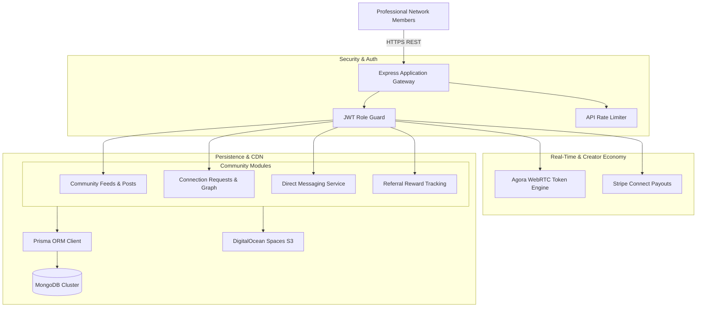

# Hannan Avtor Backend - Professional Social Network & Calling API

<p align="center">
  
</p>

<p align="center">
  <a href="https://nodejs.org"></a>
  <a href="https://expressjs.com"></a>
  <a href="https://www.typescriptlang.org"></a>
  <a href="https://www.prisma.io"></a>
  <a href="https://www.mongodb.com"></a>
  <a href="https://agora.io"></a>
  <a href="https://stripe.com"></a>
  <a href="LICENSE"></a>
</p>

---

## 📖 Overview

**hannanavtor-backend** is a social professional networking and creator collaboration API built with Node.js, Express.js, TypeScript, and Prisma ORM with MongoDB. It features interactive community discussion feeds, peer-to-peer connection requests, direct messaging, referral incentive tracking, Agora RTC audio/video calling tokens, and Stripe creator payouts.

---

## ⚡ Key Features

- 🌐 **Community Social Feeds:** User posts, engagement reactions, comment threads, and topic categorization.
- 👥 **Professional Peer Connections:** Connection request lifecycle, reciprocal followings, and contact discovery.
- 📞 **Agora WebRTC Audio/Video Tokens:** Dynamic RTC token generation for private 1-on-1 and group video/audio calls.
- 🎁 **Referral Reward Architecture:** Unique user referral codes tracking network growth, bonus balances, and commission payouts.
- 💳 **Stripe Creator Payouts:** Direct integration with Stripe Connect for balance withdrawal and creator tips.
- 🔔 **Firebase Cloud Messaging:** Instant real-time alerts for incoming calls, connection invites, and discussion replies.

---

## 🏗️ System Architecture



---

## 📂 Directory Structure

```text
.
├── src/
│   ├── app/
│   ├── components/
│   └── ...
├── assets/
│   └── banner.svg
├── .env.example
├── .gitignore
├── package.json
├── README.md
└── LICENSE
```

---

## 🛠️ Tech Stack & Dependencies

| Layer / Library | Version | Description |
|---|---|---|
| **Express.js** | `v4.21` | HTTP routing and middleware framework |
| **TypeScript** | `v5.x` | Type safety across API entities |
| **Prisma ORM** | `v6.x` | MongoDB modeling and query construction |
| **Agora RTC SDK** | `REST` | WebRTC token generation for live calls |
| **Stripe SDK** | `v17.x` | Creator economy and payout disbursements |
| **AWS SDK (S3 Client)** | `v3.x` | DigitalOcean Spaces file storage integration |

---

## ⚙️ Environment Variables

Create a `.env` file in the project root based on the provided sample:

```bash
cp .env.example .env
```

Configurable variables:

```env
PORT=4000
NODE_ENV=development
DATABASE_URL=mongodb+srv://<username>:<password>@cluster.mongodb.net/hannanavtor?retryWrites=true&w=majority

JWT_SECRET=your_jwt_secret
EXPIRES_IN=15d

# Agora RTC
AGORA_APP_ID=your_agora_app_id
AGORA_APP_CERTIFICATE=your_agora_app_certificate

# Stripe
STRIPE_PK=pk_test_your_stripe_public_key
STRIPE_SK=sk_test_your_stripe_secret_key

# DigitalOcean Spaces
DO_SPACES_ENDPOINT=https://nyc3.digitaloceanspaces.com
DO_SPACES_KEY=your_do_spaces_key
DO_SPACES_SECRET=your_do_spaces_secret
DO_SPACES_BUCKET=hannanavtor-media
```

---

## 🚀 Getting Started

### Prerequisites

- Node.js (v20.x or higher recommended)
- Package Manager (`npm`, `yarn`, or `pnpm`)

### Installation

```bash
# Clone repository
git clone https://github.com/shahjalal-labs/hannanavtor-backend.git
cd hannanavtor-backend

# Install dependencies
npm install
```

### Running Locally

```bash
# Start development server
npm run dev
# or for backend services
npm run start:dev
```

### Building for Production

```bash
# Create production build
npm run build

# Start production server
npm start
```

---

## 📄 License

This project is licensed under the [ISC License](LICENSE).
